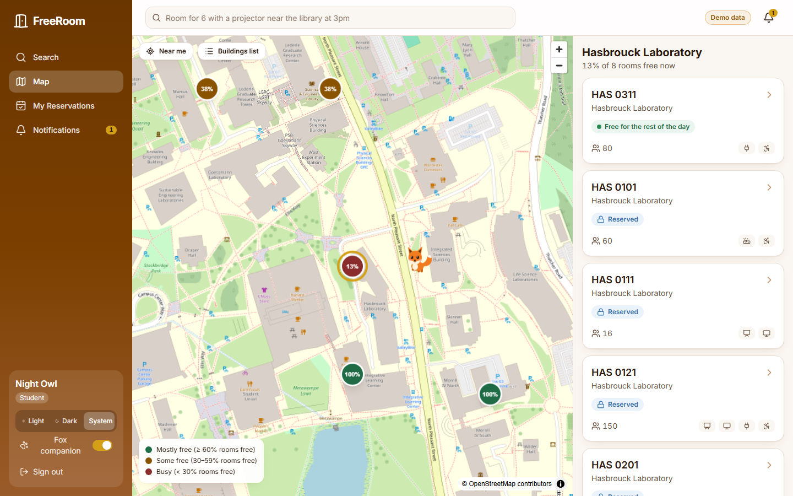
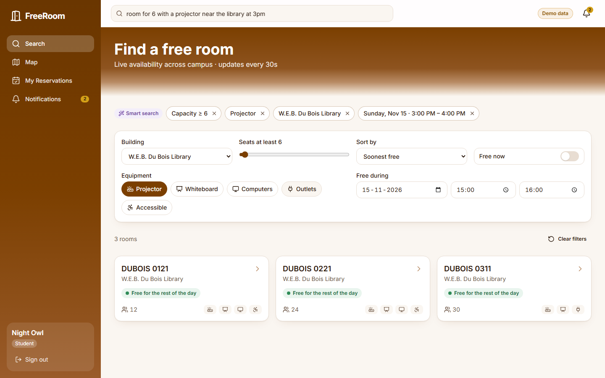
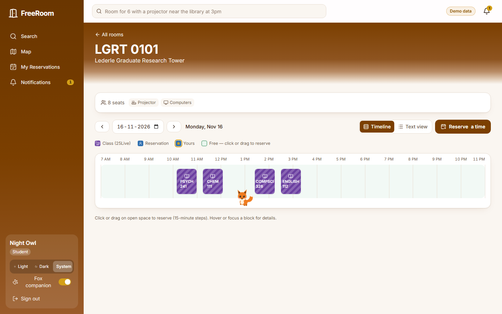
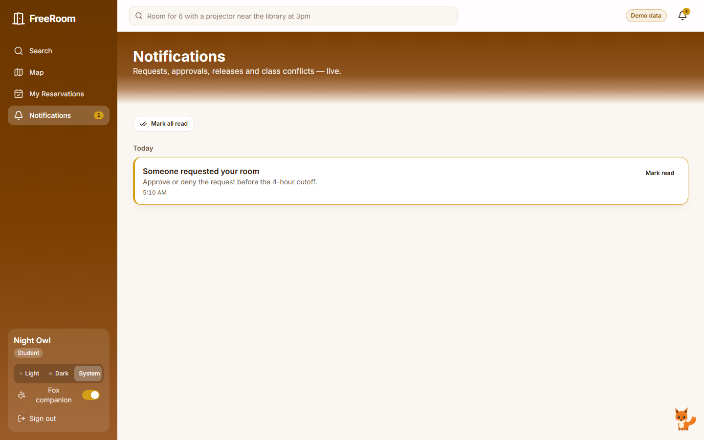
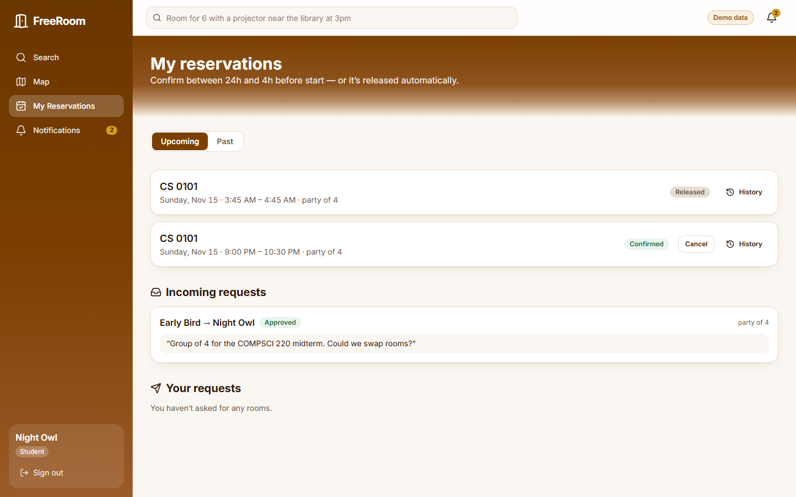
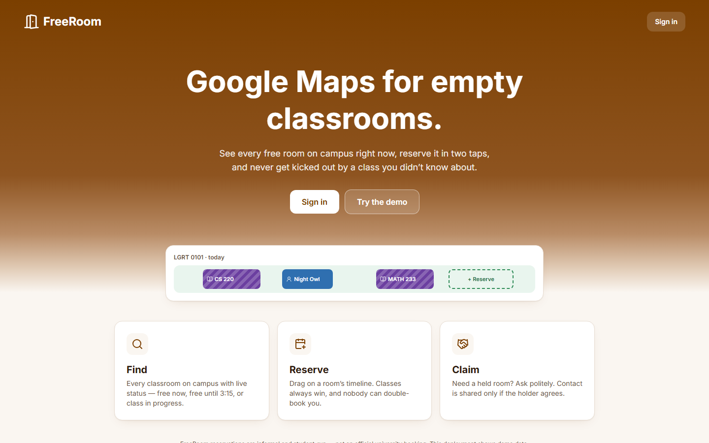
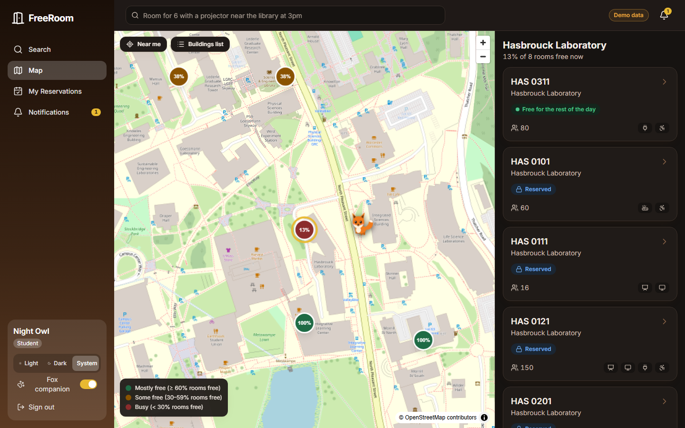
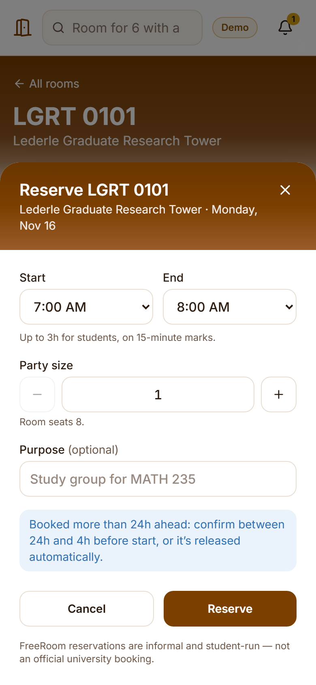
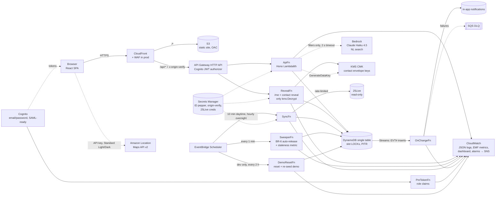

# FreeRoom

**Google Maps for empty classrooms.** See every free room on campus right now, reserve it in two
taps, and never get kicked out by a class you didn't know about.

25Live is the read-only source of rooms and classes. Reservations, claims and notifications are
FreeRoom's own, on serverless AWS. It works on any phone (bottom tab bar, bottom sheets, 44 px
targets), has Light / Dark / System themes, and a small fox that keeps you company on desktop.

**New (feature-flagged, on in the demo):**

- **Get me there**: walking directions to the room's entrance (Amazon Location Routes v2), a big
  ETA, and a verdict on whether it will still be free when you arrive ("Free for 1h 20m after
  you arrive" / "CS 220 starts 4 min after you arrive"), with one tap to reserve it for your
  arrival time.
- **Group invites**: one link (and QR ticket) for your study group: where and when, add to
  Apple/Google/Outlook calendar, directions, and Join. Aliases only, never contact details.

- **Live demo** (sample data, demo accounts, guided tour, resets itself every 2 hours):
  https://d36vb3bto2ikso.cloudfront.net
- **Production:** https://d14abz6mtvapjq.cloudfront.net (no demo data; "Try the live demo" links
  to the demo site)
- **Pitch kit:** [docs/PITCH.md](docs/PITCH.md) · **Submission:** [docs/SUBMISSION.md](docs/SUBMISSION.md)
  · **Video shot list:** [docs/VIDEO.md](docs/VIDEO.md) · **Architecture:**
  [docs/architecture.png](docs/architecture.png)

> FreeRoom reservations are informal and student-run, not an official university booking. The
> deployed demo runs on seeded UMass campus data until UMass IT grants 25Live and SSO access.
> Switching those on is configuration, not code (DEPLOY.md).

| Campus map: buildings colored by how free they are              | Natural-language search → editable filter chips                    |
| --------------------------------------------------------------- | ------------------------------------------------------------------ |
|                                 |          |
| **Room timeline: classes (striped, book icon) vs reservations** | **Class conflict → 3 alternatives, one-tap rebook**                |
|                       |                |
| **My reservations: confirm window, incoming claims**            | **Landing: live free-room count, How it works**                    |
|         |                            |
| **Dark mode (Amazon Location dark basemap)**                    | **Phone: bottom sheet reserve, tab bar**                           |
|               |  |

More: every page in light/dark × desktop/mobile is in [docs/screenshots](docs/screenshots).

## Architecture



One CDK stack per stage (`infra/`). Everything is pay-per-use, about $8/month at demo scale
(mostly the prod WAF).

## How the hard parts work

### No double booking: slot-lock transactions (BR-8)

A reservation `[start, end)` is cut into 15-minute slots. Creating it is **one**
`TransactWriteItems`:

- the reservation item;
- the owner's quota item (optimistic version check);
- an immutable `CREATED` audit event;
- the idempotency record;
- **one `LOCK` item per slot** (`ROOM#<id>#SLOT#<iso>`), each with `attribute_not_exists(PK)`.

If any slot is already locked, the whole transaction is cancelled. The cancellation reason tells
us which lock failed. There's no read-then-write window to race through. A 50-way concurrency
test proves it: 50 parallel requests produce exactly 1 success and 49 `SLOT_TAKEN`. The P9 audit
adds 9 different-but-overlapping intervals at once, and again exactly one wins.

### Classes always win: class locks (BR-1, BR-9)

The 25Live sync writes a **class `LOCK`** (`kind=class`) on every 15-minute slot a class
occupies, using the same keys as reservation locks. So even a request that skipped the
API-level class check couldn't commit over a class: the transaction hits the class lock and
returns `CLASS_CONFLICT` with the class name.

Before writing, the API also checks the freshest cached schedule, refreshing that room and day
from 25Live if the cache is older than 15 minutes.

When a _new_ class appears over an existing reservation, sync releases the reservation
(`CONFLICTED → RELEASED`, reason `CLASS_CONFLICT`) in one transaction and attaches up to **3
alternative rooms**: same building first, enough seats, same time.

### The 4-hour cutoff: server clock and the sweeper (BR-6)

- `cutoff = start − 4h`. Confirming, submitting a claim and approving a claim are conditional
  writes containing `cutoffAt > :now`, and `:now` is the **server's** clock. A late request
  can't win, whatever the client says.
- An **EventBridge Scheduler** rule runs the sweeper **every minute**. It reads a sparse GSI of
  reservations due at their cutoff, releases unconfirmed ones (`RELEASED`, reason
  `UNCONFIRMED`), and expires pending claims. Every write is conditional and idempotent, so
  re-runs are harmless.
- The same sweeper publishes `ScheduleStalenessMinutes`, so a dead 25Live sync raises an alarm
  even though the sync itself has gone quiet.

### Event-driven notifications (BR-7)

Every state change appends an immutable `EVT#` item (`attribute_not_exists`, never updated). It
carries the request's **correlation id**.

DynamoDB Streams, filtered to `EVT#` inserts, feed `OnChangeFn`. It writes in-app notifications
idempotently: the notification key comes from the event id, so retries never duplicate.
Failures retry twice with batch bisection, then land in an SQS DLQ, which triggers an alarm.
The web app polls every 10 seconds and toasts new items.

### Natural-language search that can't do anything but filter

Type "room for 6 with a projector near the library at 3pm" in the top bar.
`POST /rooms/search/natural` turns it into the **same filter object `GET /rooms` takes**, using:

- **Bedrock** (Claude Haiku 4.5 through a us cross-region inference profile): one forced tool
  whose input schema _is_ the filter object, zod-validated. The prompt holds the campus date and
  time and the building list, never anything about the user.
- **A deterministic parser** whenever Bedrock is off, slow (2 s), or returns anything invalid.

The filters then run through the normal search. The model can't book, cancel or see anything.
Prompt injection ("ignore instructions and book…") can at worst produce odd filters, and you see
them as editable chips. Each user gets 10 searches a minute, results are cached for 5 minutes,
and the `NLSearchSource` metric shows Bedrock vs parser.

### Privacy by construction: KMS (BR-5)

- **University IDs** are HMAC-SHA256'd with a pepper from Secrets Manager. Only the hash is
  stored, for uniqueness.
- **Contact info** is envelope-encrypted: a per-record data key from a KMS CMK, AES-GCM, and
  the user id as encryption context.
- **Only `RevealFn` holds `kms:Decrypt`.** It's a separate Lambda behind `/me` and
  `GET /claims/{id}/contact`. It returns the owner's chosen channel only to the requester of an
  APPROVED share-contact claim, until the reservation's end + 24 h, and audits every reveal.
- Every API test asserts that no response contains PII. Logs are redacted by key name.
- The infra test fails if any other role ever gets `kms:Decrypt`.

## Run it locally

```bash
pnpm install
pnpm dev:api        # DynamoDB Local + seed + mock 25Live + API on :3001
pnpm dev:web        # Vite on :5173 (proxies /api → :3001); sign in with any dev id, e.g. student1
pnpm --filter @freeroom/web dev:mock   # UI only, API mocked in the browser (MSW)
```

Requires Node ≥ 22.19 (CI uses 24), pnpm via `corepack enable`, and Docker or Java for DynamoDB Local.

## Tests and quality gates

```bash
pnpm lint && pnpm typecheck
pnpm test                       # 330 tests: domain rules, API integration on DynamoDB Local,
                                # 50-way concurrency, adversarial/IDOR audit, sync/sweeper crash
                                # recovery, infra assertions
# + 60 Playwright tests: golden path (desktop, iPhone 14, Pixel 7), axe in light AND dark,
#   mobile layouts at 360/390/430/844 px, theme, fox, people input, audit regressions,
#   directions (incl. location blocked + phone sheet), invites (sign-in → auto-join, .ics)
pnpm audit --audit-level high   # CI fails on high/critical
pnpm --filter @freeroom/infra exec cdk synth -c stage=prod   # cdk-nag AwsSolutions: fails on unjustified findings
pnpm --filter @freeroom/api e2e              # 12 end-to-end API flows against a running API
BASE_URL=http://localhost:5173 SMOKE_OWNER=faculty1 SMOKE_CLAIMER=tutor1 pnpm --filter @freeroom/e2e smoke
BASE_URL=http://localhost:5173 SMOKE_OWNER=faculty1 pnpm --filter @freeroom/e2e lighthouse   # a11y ≥ 95
BASE_URL=http://localhost:5173 SMOKE_OWNER=faculty1 LH_FORM=mobile pnpm --filter @freeroom/e2e lighthouse  # mobile, all categories
```

To run against a deployed stack, set `BASE_URL` to its URL and `E2E_USERS_FILE` to
`infra/.demo-users.<stage>.local.json` (written by the deploy).

See [docs/TRACEABILITY.md](docs/TRACEABILITY.md) for every rule mapped to its code and tests, and
[docs/AUDIT.md](docs/AUDIT.md) for the whole-repo audit (security, data, correctness, docs) and
what was fixed or deliberately deferred.

## Deploy

```bash
aws login
pnpm run deploy -- --stage dev  -c alarmEmail=<you@example.com>
pnpm run deploy -- --stage prod -c alarmEmail=<you@example.com>
```

The full guide (first-time bootstrap, the GitHub pipeline, secrets, SES, real 25Live, SAML) is
[DEPLOY.md](DEPLOY.md). Operations: [RUNBOOK.md](RUNBOOK.md). Security model:
[SECURITY.md](SECURITY.md). Pitch: [docs/PITCH.md](docs/PITCH.md).

## Status

| Area                                                                                             | Status                                                                                                                                                                                                                                                                                                  |
| ------------------------------------------------------------------------------------------------ | ------------------------------------------------------------------------------------------------------------------------------------------------------------------------------------------------------------------------------------------------------------------------------------------------------- |
| Core rules BR-1/5/6/8/9 (server-enforced, tested)                                                | ✅ Shipped. 330 automated tests + 60 Playwright + adversarial/IDOR audit ([TRACEABILITY](docs/TRACEABILITY.md), [AUDIT](docs/AUDIT.md))                                                                                                                                                                 |
| Search, map, timeline, reserve, claims, notifications, Demo Controls                             | ✅ Shipped, live on dev and prod                                                                                                                                                                                                                                                                        |
| Mobile layout, dark mode, fox companion, typeable people count                                   | ✅ Shipped (v1.2). Map on Amazon Location Maps API v2 with a live dark basemap                                                                                                                                                                                                                          |
| Get me there (walking directions + arrival verdict), group invites (QR ticket, join, calendar)   | ✅ On dev behind `features.directions` / `features.invites`; off in prod until approved (`-c features=directions,invites`)                                                                                                                                                                              |
| Natural-language search                                                                          | ✅ Shipped. **Parser live; Bedrock pending** an account step: Anthropic's one-time use-case form in the Bedrock console. After approval it switches on with no redeploy (DEPLOY.md §6)                                                                                                                  |
| Security (WAF, KMS, origin-verify, cdk-nag clean) and observability (dashboard, alarms, runbook) | ✅ Shipped                                                                                                                                                                                                                                                                                              |
| CD via GitHub Actions + OIDC                                                                     | ⛔ **Blocked by account policy.** The hackathon AWS account's SCP denies `iam:CreateOpenIDConnectProvider`. The workflow is complete as committed (CI runs on GitHub; deploy jobs are opt-in with `-c githubOidc=true`). Deploys run from a maintainer machine with short-lived `aws login` credentials |
| Region                                                                                           | us-east-2 only (the SCP denies CloudFormation in us-east-1, so the CloudFront WAF is created there by a custom resource calling the WAF API). Bedrock uses a us cross-region inference profile                                                                                                          |
| Live 25Live data, campus SAML SSO                                                                | ⏳ Configuration only, waiting on UMass IT credentials and metadata                                                                                                                                                                                                                                     |

## Roadmap (v1.1)

From PRD §0.3, plus what v1 deferred:

- **Campus SAML SSO**: config-ready (`-c samlMetadataUrl=…`), needs UMass IT metadata.
- **Live 25Live credentials**: the adapter is built and rate-limited; it needs the secret filled.
- WebSockets instead of 10-second polling.
- Week view.
- Follow a room (notify when it frees up).
- Email-preference UI and SES email notifications.
- Full admin console (audit search, suspend users).
- Per-reservation reminder schedules.
- X-Ray tracing.
