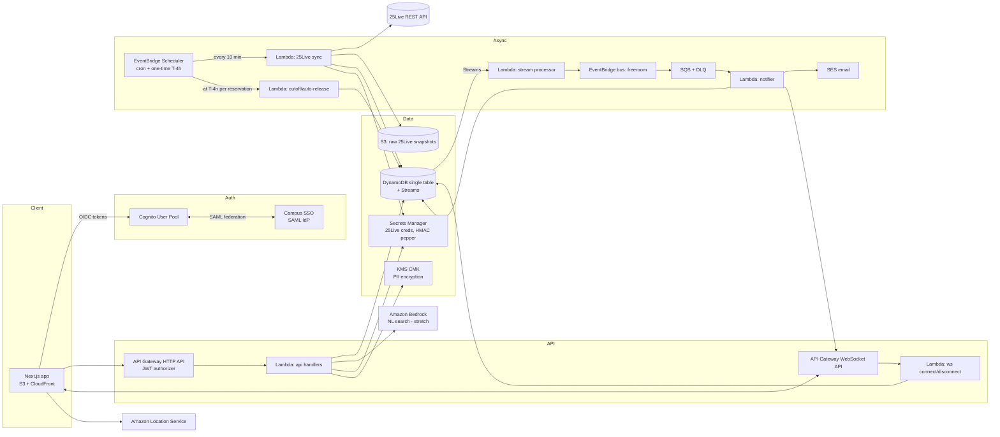

# FreeRoom — Product Requirements Document

**Version:** 1.0 (v1 / hackathon build)
**Author:** Lakshman Lakshminaathan
**Date:** 2026-11-14
**Status:** Draft for build

---

## 0. RELEASE SCOPE: PRODUCTION-READY v1 BY THE HACKATHON DEADLINE (overrides the rest of this PRD)

The hackathon ends on **Sunday 2026-11-15**. The goal is a **production-ready v1** by then: deployed on AWS, secure, tested, monitored, and shipped through CI/CD, with every core business rule enforced. Everything after §0 is the full product vision. Where §0 and the rest of the PRD disagree, §0 wins.

### 0.1 Definition of "production-ready" (the release gate; all must be true)
1. Deployed to AWS from `main` by the GitHub Actions pipeline (OIDC, no long-lived keys). The web app is served over HTTPS via CloudFront.
2. BR-1, BR-5, BR-6, BR-8, and BR-9 are enforced on the server and covered by automated tests (unit + integration against DynamoDB Local + concurrency test). CI is green.
3. No PII leaks: University IDs are stored only as an HMAC; contact info is KMS-encrypted and returned only by the reveal route (contract tests prove it); logs are redacted.
4. Abuse protection: WAF rate-based rule + AWS managed rules on CloudFront, API throttling, per-user quotas, zod input validation everywhere.
5. Operability: structured JSON logs with correlation IDs, a CloudWatch dashboard, alarms (API 5xx, Lambda errors, sync failures, staleness, stream-processing errors) emailed via SNS, DynamoDB PITR on, a documented runbook.
6. Quality: Playwright smoke suite passing against the deployed URL. Keyboard-accessible UI with color + icon + text statuses. Lighthouse accessibility ≥ 95.
7. Docs: README, DEPLOY.md, RUNBOOK.md, SECURITY.md.

**External dependencies (outside our control):** live 25Live data and campus SSO require credentials and SAML metadata from UMass IT. v1 ships with a production-grade `ScheduleSource` adapter plus seeded campus data, and Cognito email/password with University ID registration. Switching on real 25Live and SAML is configuration (credentials in Secrets Manager, IdP metadata in context), not new code. This is stated clearly in the UI ("Demo data") and in the pitch.

### 0.2 In scope for v1
| Area | v1 |
|---|---|
| BR-1 class conflict | Server-side check plus **class slot locks** in DynamoDB |
| BR-8 no double booking | `TransactWriteItems` slot locks + a 50-way concurrency test |
| BR-6 4h cutoff | Domain rules + tests. Auto-release by a **sweeper Lambda every 1 min** (EventBridge Scheduler), idempotent conditional writes |
| BR-5 contact reveal | Claim → approve (share contact or transfer) → reveal. Contact is **KMS envelope-encrypted**; only the reveal Lambda and `/me` can decrypt |
| BR-9 class wins | Sync detects the conflict → release + notification with 3 alternatives (demo: "inject class") |
| BR-2/BR-3/BR-7 | Distinct layers + full class tooltip; immutable audit events |
| Features | Search + filter, room timeline (day view), campus map (Amazon Location), claims, My Reservations, in-app notifications (+ SES email when an identity is verified), landing, registration, admin Demo Controls |
| Event-driven | DynamoDB Streams → `onChange` Lambda (DLQ on failure) → notifications |
| Real-time | 10-second polling (WebSockets are v1.1) |
| Auth | Cognito email/password + `/register` with University ID (HMAC), roles via a pre-token Lambda. SAML federation is config-ready |
| 25Live | `ScheduleSource` interface; `RealTwentyFiveLiveSource` with rate limiting/backoff (activated by credentials); `MockSource` with seeded UMass data |
| AWS | CDK: DynamoDB, API Lambda (Hono) + HTTP API, sweeper/sync/onChange/reveal Lambdas, Cognito, KMS, Secrets Manager, S3 + CloudFront + WAF, Amazon Location, CloudWatch + SNS, Bedrock |
| Stretch | Natural-language search via Bedrock |

### 0.3 Deferred to v1.1 (roadmap slide)
Campus SAML SSO activation · live 25Live credentials · WebSockets · week view · follows · email-preference UI · full admin console (audit search, suspend) · per-reservation reminder schedules · X-Ray tracing.

### 0.4 Schedule (Sat 3am → Sun deadline)
| When | Track A: backend (Claude Code session 1) | Track B: frontend (Claude Code session 2) |
|---|---|---|
| Sat 03–05 | **P1** Scaffold + domain rules + tests + CI (run alone) | Run the Claude Design prompt and review its screens |
| Sat 05–09 | **P2** Data layer + API + 25Live adapter + reservations | **P5** Shell + search + timeline + reserve (mocked API) |
| Sat 09–12 | **P3** Auth + claims + KMS + sweeper + notifications | **P6** Map + claims UI + My Reservations + notifications + demo panel |
| Sat 12–14 | **P4** CDK infrastructure → **first deploy** | Wire to the real API |
| Sat 14–19 | **P7** Integration on the live stack + bug-fix | Polish to match the design |
| Sat 19–Sun 01 | **P8** Production hardening: WAF, alarms, dashboard, CD pipeline, e2e smoke, docs | |
| Sun 01–05 | **P9** Bedrock NL search + pitch kit + release audit | |
| Sun AM | Rehearse the demo 3×, record a backup video, submit early | |

**Rule:** if behind schedule, drop the Bedrock search first. Never drop anything in the §0.1 release gate.

---

## 1. Summary

FreeRoom is a web app that shows every classroom on campus, what's happening in each room over time, and lets students, faculty/staff, and tutors reserve rooms that are actually free. It combines two data sources:

1. **25Live** (CollegeNET), the source of truth for rooms and scheduled classes/events. Read-only for us.
2. **FreeRoom reservations**, which we create, store, and own.

**One-line pitch:** *"Google Maps for empty classrooms. See every free room on campus right now, reserve it in two taps, and never get kicked out by a class you didn't know about."*

### 1.1 Problem
- Students wander buildings looking for empty rooms. Study-room booking systems cover only a small set of library rooms.
- 25Live shows the class schedule but isn't built for informal, student-facing use: there's no "free right now near me" view.
- Informal claims ("I've been here since 2pm") lead to conflict. Nobody can see who holds a room, and there's no way to negotiate.

### 1.2 Goals (v1)
| # | Goal | Success metric (demo/pilot) |
|---|------|------------------------------|
| G1 | Find a free room fast | Under 10 s from opening the app to finding a free room that matches your filters |
| G2 | Zero reservations over classes | 0 accepted reservations overlapping a 25Live class (enforced on the server, tested) |
| G3 | Zero double bookings | 0 overlapping reservations under concurrent load (load test: 50 parallel attempts → exactly 1 success) |
| G4 | Fair handoff | Claim requests resolved or expired by T−4h, 100% of the time |
| G5 | Trust and privacy | No University ID or contact info leaks in any API response (automated contract tests) |

### 1.3 Non-goals (v1)
- Editing or writing back to 25Live.
- In-app chat or negotiation (negotiation happens off-app after contact reveal).
- Payments, recurring reservations, room check-in hardware, native mobile apps (the web app is responsive and works as a PWA).

---

## 2. Users and roles

| Role | Who | Typical job |
|------|-----|-------------|
| **Student** | Undergrad/grad | "Find me a quiet room for 4 near the CS building at 3pm." |
| **Faculty/Staff** | Instructors, TAs, staff | "Find a room with a projector for office hours / a review session." |
| **Tutor** | Private tutors and study-group leads (must be registered university affiliates) | "Book a room for my group of 8 every Tuesday" (recurring is v2; v1 is single bookings). |
| **Admin** | FreeRoom operators | Moderate abuse, force-release, view audit logs and sync health. |

### 2.1 Permissions matrix

| Action | Student | Faculty/Staff | Tutor | Admin |
|---|:-:|:-:|:-:|:-:|
| Browse rooms, timeline, map | ✅ | ✅ | ✅ | ✅ |
| Create reservation | ✅ (max 2 active, ≤ 3 h each) | ✅ (max 5 active, ≤ 4 h) | ✅ (max 3 active, ≤ 3 h) | ✅ |
| Cancel own reservation | ✅ | ✅ | ✅ | ✅ (any) |
| Submit claim/negotiate request | ✅ | ✅ | ✅ | ✅ |
| Approve/deny claims on own reservation | ✅ | ✅ | ✅ | ✅ (any) |
| Follow a reservation or room | ✅ | ✅ | ✅ | ✅ |
| Force-release / ban user | ❌ | ❌ | ❌ | ✅ |
| View audit log / sync dashboard | ❌ | ❌ | ❌ | ✅ |

Defaults: the quotas and max durations above are config values (SSM Parameter Store), not hardcoded.

---

## 3. Core business rules (normative)

These rules are **invariants**. Each one gets unit tests in `packages/domain` and integration tests at the API layer.

**BR-1: No reservations over classes.** A reservation `[start, end)` is rejected if it overlaps any 25Live class/event in the same room. Overlap means `a.start < b.end && b.start < a.end` (half-open intervals: back-to-back is allowed). This is enforced **on the server at write time** against the freshest cached 25Live data, with an on-demand 25Live refresh for that room/day when the cache is older than `CLASS_CACHE_MAX_STALENESS` (default 15 min). The UI check is only advisory.

**BR-2: Classes ≠ reservations.** Each is its own type in the API (`kind: "class" | "reservation"`) and is visually distinct everywhere: color *and* pattern/icon, so the difference doesn't rely on color alone (accessibility).

**BR-3: Class tooltips.** Hovering or focusing a class shows everything 25Live gives us: event name, course code/section, event type, start–end time, organization/department, and room/building. Tooltips are keyboard-reachable (focus) and screen-reader-announced.

**BR-4: Single owner.** Every reservation has exactly one `ownerId` (a registered user). Ownership changes only through an approved claim (transfer) or an admin action.

**BR-5: Private contact info.** Owner contact info is never returned by any endpoint unless there's an `APPROVED` claim linking requester and owner. The reveal is scoped: only that requester, only for that reservation, and it expires at reservation end + 24 h. The app shows *that* a room is held, plus the owner's display alias (e.g., "Held by a Student · claimable"), never their identity.

**BR-6: Confirmation and 4-hour cutoff.**
- Let `T` = reservation start. `cutoff = T − 4h`.
- A new reservation starts as `PENDING_CONFIRMATION`. The owner must **confirm** between `T − 24h` and `cutoff`. If it isn't confirmed by `cutoff`, it is **auto-released** (`RELEASED`, reason `UNCONFIRMED`).
- **Default (to confirm):** if a reservation is created *after* `T − 24h`, creating it counts as confirming (status `CONFIRMED` immediately). If it's created *after* `cutoff`, it's `CONFIRMED` and **not claimable**.
- Claims can only be **submitted** before `cutoff`. Owners can only **approve** before `cutoff`. At `cutoff`, every `PENDING` claim becomes `EXPIRED`. **No acceptance is ever allowed at or after `cutoff`**, enforced with a server-side clock check inside the conditional write.
- Unanswered claim → `EXPIRED`. The reservation stays with the owner (the claim expires; the reservation is not released). *(Alternative to confirm: if the owner ignores N claims, release the room. Not in v1.)*

**BR-7: Audit and surfacing.** Every change (`CREATED`, `CONFIRMED`, `CLAIM_REQUESTED`, `CLAIM_APPROVED`, `CLAIM_DENIED`, `CLAIM_EXPIRED`, `TRANSFERRED`, `RELEASED`, `CANCELLED`, `CONFLICTED`) appends an immutable `ReservationEvent`. Affected users (owner, claimant, followers) get in-app plus real-time notifications, and email for important events.

**BR-8: No double booking.** Two reservations for the same room can never overlap, even with concurrent writes. This is guaranteed at the database level (see §6.3), not by read-then-write checks.

**BR-9: 25Live wins.** If a newly synced class overlaps an existing reservation, the reservation becomes `CONFLICTED` → `RELEASED` (reason `CLASS_CONFLICT`). The owner is notified right away with the class details and **up to 3 alternative free rooms** (same building first, then nearest, capacity ≥ party size, same time window), with one-tap rebook.

**BR-10: Time.** All times are stored in UTC (ISO-8601) and displayed in campus local time (`America/New_York`). The slot granularity is 15 minutes, and reservation start/end must be on 15-minute boundaries.

---

## 4. Features (v1)

### F1. Search and filter
- Filters: building, min capacity, equipment (projector, whiteboard, computers, outlets, accessibility features), "free now", "free from X to Y".
- Results show a live status chip: 🟢 Free (until 3:15pm) · 🟣 Class in progress · 🔵 Reserved (claimable) · ⚪ Reserved.
- Sort by: soonest free, longest free block, capacity, distance (if location permitted).
- **Stretch (strong for judges): natural-language search** via Amazon Bedrock. For example, "quiet room for 6 with a projector near the CS building at 3pm tomorrow" is parsed into structured filters. The LLM only produces a filter object, and the existing search does the rest, so results stay deterministic and can't be prompt-injected into making bookings.

### F2. Room timeline/calendar
- Day view (default) and week view per room. There are two layers: **Classes** (from 25Live, purple, striped pattern, 📘 icon) and **Reservations** (ours, blue solid, 👤 icon; your own get a gold outline).
- Click or drag on a free gap to start a reservation; gaps that are too short or blocked by a class are not selectable.
- Tooltips per BR-3. Reservations show status, the owner alias, and a "Request this room" button if claimable.
- Accessibility: the timeline is a structured list/grid with ARIA (`role="grid"` or a list of time blocks), arrow-key navigation between blocks, Enter to open details, and a "Text view" toggle.

### F3. Campus map
- Amazon Location Service map (MapLibre GL). Building markers are colored by aggregate availability (% of rooms free now) and update in real time.
- Clicking a building opens a list of its rooms with status chips, and from there the timeline.
- "Near me" uses browser geolocation (opt-in; never stored on the server).

### F4. Notifications and alerts
- In-app notification center (bell), real-time over WebSocket, plus email via SES for: claim received, claim approved (with contact reveal), claim denied/expired, confirmation reminder (T−24h and T−6h), auto-released, class conflict, transferred.
- Users can **follow** a reservation or a room ("notify me when Room X frees up 2–4pm").
- Per-user notification preferences (email on/off per category).

### F5. Claim/negotiate flow
1. A requester opens a claimable reservation → "Request this room" with an optional message (≤ 280 chars, sanitized) and their party size.
2. The owner is notified and can approve or deny until `cutoff`.
3. **Approve** → the requester sees the owner's chosen contact channel (email or phone, whichever the owner set as shareable). The owner chooses at approval time between **"Share contact only"** (they negotiate off-app) and **"Transfer reservation"** (ownership moves to the requester immediately, `TRANSFERRED`).
4. **Deny** → the requester is notified. **No response by `cutoff`** → `EXPIRED`.
5. Limits: a user can have at most 3 open claims, and only 1 open claim per reservation.

### F6. My Reservations
Upcoming / past, status, a confirm button (with countdown to cutoff), cancel, incoming and outgoing claims, and an event history per reservation.

### F7. Admin console (minimal)
Sync health (last successful sync, error rate, staleness per building), audit log search, force-release, user suspend.

---

## 5. Architecture

### 5.1 Diagram



### 5.2 Service choices (with justification)

| Concern | Choice | Why |
|---|---|---|
| Frontend hosting | **Next.js (static export) on S3 + CloudFront** | Cheapest and fastest option. Everything dynamic comes from the API, so we don't need SSR. Using CDK for both keeps one IaC tool (Amplify Hosting is a fine alternative). |
| Auth | **Cognito User Pool + SAML federation to campus SSO** | Native AWS. The SAML IdP gives a verified campus identity. A pre-token-generation Lambda injects `role` and `registered` claims. A **demo IdP mode** (Cognito native users) is available for hackathon judging when campus SSO metadata isn't obtainable. |
| API | **API Gateway HTTP API + Lambda (Node 20, TypeScript)** | Serverless, scales to zero, JWT authorizer built in, and HTTP API is about 70% cheaper than REST API. |
| Real-time | **API Gateway WebSocket API** | Push status changes to open timelines/maps. Cheaper and simpler than AppSync for this shape. |
| Primary DB | **DynamoDB (single table, on-demand)** | Access patterns are known and key-based. Transactional conditional writes give race-free double-booking prevention (§6.3). Streams provide the event-driven backbone. TTL handles cleanup. See §6.1 for why not Aurora. |
| Events | **DynamoDB Streams → Lambda → EventBridge custom bus → SQS (+ DLQ) → consumers** | Streams capture *every* modification, including ones made by the sync and release jobs. EventBridge gives routing/fan-out and replay (archive). SQS adds buffering and retries. |
| Scheduled sync | **EventBridge Scheduler → Lambda** | Cron for 25Live pulls, plus **one-time schedules** at each reservation's `T−4h` for precise cutoff handling. A 5-minute sweeper is the backstop. |
| Notifications | **SES** (email), **WebSocket** (real-time), DynamoDB (in-app inbox) | SNS isn't needed for user-facing fan-out. EventBridge + SQS already fan out. |
| Map | **Amazon Location Service** (Maps + Places) + MapLibre GL | Sponsor requirement, and its free tier covers the demo. |
| Secrets | **Secrets Manager** (25Live credentials, HMAC pepper), **KMS CMK** (PII envelope encryption) | Least privilege, rotation, audit via CloudTrail. |
| Raw snapshots | **S3** | Store raw 25Live responses for debugging/replay. Lifecycle rule deletes after 30 days. |
| Observability | **CloudWatch** Logs (structured JSON via Powertools), metrics (EMF), alarms → SNS → email; **X-Ray** tracing | Native, so it needs zero extra vendors. |
| IaC | **AWS CDK (TypeScript)** | Same language as the app, high-level constructs, `cdk-nag` for security checks. |
| CI/CD | **GitHub Actions + OIDC → AWS** (no long-lived keys) | Lint/test/synth on PR; deploy `dev` on merge to main, `prod` on tag. |
| NL search (stretch) | **Amazon Bedrock** (Claude via Bedrock) | Sponsor-aligned "wow" feature that only produces a structured filter, never takes actions. |

### 5.3 Repo layout (monorepo, pnpm workspaces)

```
freeroom/
  apps/web/                 Next.js 15 app (App Router, static export), Tailwind, shadcn/ui
  services/api/             Lambda handlers (HTTP, WS, stream, sync, notifier, release)
  packages/domain/          PURE business rules: intervals, slots, state machines, cutoff, permissions (no AWS imports)
  packages/shared/          zod schemas + TS types shared by web and api (API contract)
  packages/twentyfive-live/ 25Live client + mapper + mock server
  infra/                    CDK app (stacks: Data, Auth, Api, Async, Web, Observability, Pipeline)
  docs/                     PRD.md, ARCHITECTURE.md, API.md, ADRs
  CLAUDE.md
```

---

## 6. Data model

### 6.1 DynamoDB vs Aurora: recommendation

**DynamoDB.** Reasons:
1. Every read is key-based (room+day, user's reservations, reservation by id, claims by reservation, notifications by user).
2. **Double-booking prevention** works atomically and without locks: a reservation writes one *slot-lock item* per 15-minute slot in a `TransactWriteItems` with `attribute_not_exists` conditions. Any overlap fails the entire transaction.
3. Streams give us the event-driven change feed the brief requires, with no polling.
4. Serverless, scales to zero, no VPC (Aurora would need a VPC and NAT, which add cost and cold-start pain for Lambda).

Trade-off: ad-hoc analytics are harder. Mitigation: export to S3 and query with Athena (v2).

### 6.2 Single-table design: `FreeRoomTable`

| Entity | PK | SK | Key attributes | Notes |
|---|---|---|---|---|
| Building | `BLDG#{buildingId}` | `META` | name, lat, lng, campusZone | from 25Live + geocode seed |
| Room | `ROOM#{roomId}` | `META` | buildingId, name, capacity, equipment[], features[], lat/lng, twentyFiveLiveId, lastSyncedAt | GSI1: `BLDG#{buildingId}` / `ROOM#{roomId}` |
| Class/Event (cached) | `ROOM#{roomId}#DAY#{yyyy-mm-dd}` | `CLASS#{startIso}#{eventId}` | name, courseCode, section, eventType, org/department, start, end, sourceHash, syncRunId | written by sync only; TTL = end + 7d |
| Reservation | `RES#{resId}` | `META` | roomId, ownerId, start, end, partySize, status, purpose(optional), version, createdAt, cutoffAt, confirmedAt | GSI1: `ROOM#{roomId}#DAY#{day}` / `RES#{startIso}#{resId}`; GSI2: `USER#{ownerId}` / `RES#{startIso}` |
| Slot lock | `ROOM#{roomId}#SLOT#{slotStartIso}` | `LOCK` | resId, expiresAt | one per 15-min slot; max 16 per reservation (4h); deleted on release/cancel; TTL safety net |
| Claim | `RES#{resId}` | `CLAIM#{claimId}` | requesterId, ownerId, message, partySize, status, mode, createdAt, expiresAt(=cutoff) | GSI2: `USER#{requesterId}` / `CLAIM#{createdAt}`; GSI3: `USER#{ownerId}#INCOMING` / `CLAIM#{createdAt}` |
| Reservation event (audit) | `RES#{resId}` | `EVT#{tsIso}#{eventId}` | type, actorId, before, after, reason | immutable, append-only |
| User | `USER#{userId}` | `PROFILE` | role, displayAlias, emailEnc, phoneEnc, shareChannel, uidHash, notificationPrefs, status | `userId` = Cognito `sub`; contact fields **KMS-encrypted** |
| UID uniqueness | `UID#{hmac(universityId)}` | `UID` | userId | enforces one account per University ID; raw ID never stored |
| Follow | `USER#{userId}` | `FOLLOW#{targetType}#{targetId}` | window(optional) | GSI4 (reverse): `FOLLOWERS#{targetType}#{targetId}` / `USER#{userId}` |
| Notification | `USER#{userId}` | `NOTIF#{tsIso}#{id}` | type, resId, title, body, read | TTL 30 days |
| WS connection | `USER#{userId}` | `WSCONN#{connectionId}` | subscribedRooms[] | GSI4: `WSROOM#{roomId}` / `CONN#{connectionId}`; TTL 2h |
| Contact reveal | `RES#{resId}` | `REVEAL#{requesterId}` | claimId, expiresAt | TTL; checked before returning contact |
| Sync run | `SYNC#{source}` | `RUN#{tsIso}` | status, counts, errors, durationMs | admin dashboard |
| Idempotency | `IDEMP#{key}` | `IDEMP` | response, TTL 24h | for POST /reservations |

**Access patterns → keys**

| # | Pattern | Key |
|---|---|---|
| AP1 | Rooms by building | GSI1 `BLDG#` |
| AP2 | Classes for room on day | PK `ROOM#..#DAY#..` begins_with `CLASS#` |
| AP3 | Reservations for room on day | GSI1 `ROOM#..#DAY#..` begins_with `RES#` |
| AP4 | My reservations (upcoming) | GSI2 `USER#{id}` begins_with `RES#`, SK ≥ now |
| AP5 | Claims on a reservation | PK `RES#` begins_with `CLAIM#` |
| AP6 | My outgoing / incoming claims | GSI2 / GSI3 |
| AP7 | Reservation history | PK `RES#` begins_with `EVT#` |
| AP8 | My notifications | PK `USER#` begins_with `NOTIF#` (desc) |
| AP9 | Followers of a reservation/room | GSI4 `FOLLOWERS#` |
| AP10 | WS connections viewing a room | GSI4 `WSROOM#` |
| AP11 | Campus-wide "free now" | Precomputed `AVAIL#{buildingId}` items updated by stream processor + sync (avoids scanning) |

Search across all rooms (filter by capacity/equipment) uses a **room catalog snapshot**. The room set is small (~hundreds to low thousands), so the API caches the full catalog in Lambda memory (refreshed every 5 min) and filters in memory. That makes it fast and cheap with no OpenSearch needed.

### 6.3 Concurrency: how double-booking is impossible

`createReservation` runs one `TransactWriteItems` containing:
1. `Put RES#{id}/META` with `attribute_not_exists(PK)`.
2. `Put ROOM#{r}#SLOT#{t}/LOCK` for each 15-min slot, each with `attribute_not_exists(PK)`.
3. `Put RES#{id}/EVT#…` (CREATED).
4. `ConditionCheck` on the user's active-count quota item.

If any slot is taken, DynamoDB rejects the whole transaction (`TransactionCanceledException` with `ConditionalCheckFailed`), and the API returns `409 SLOT_TAKEN`. The class-conflict check (BR-1) runs right before the transaction against fresh class data. To close the race with a sync landing between check and write, the sync job also writes **class slot locks** (`LOCK` items with `kind=class`) for every class slot. That way a reservation physically can't take a class slot, and a new class landing on a reserved slot is detected by the sync (BR-9) and resolved by releasing the reservation.

### 6.4 State machines

**Reservation:** `PENDING_CONFIRMATION → CONFIRMED → (COMPLETED | CANCELLED | TRANSFERRED→CONFIRMED[new owner])`; any non-terminal state → `RELEASED` (reasons: `UNCONFIRMED`, `CLASS_CONFLICT`, `ADMIN`) or `CANCELLED` (by owner).

**Claim:** `PENDING → APPROVED | DENIED | EXPIRED | WITHDRAWN`. `APPROVED` is only reachable when `now < cutoffAt` (checked with a `ConditionExpression` on `cutoffAt > :now`, plus the domain check).

---

## 7. API specification (v1)

Base: `https://api.<domain>/v1`. Auth: `Authorization: Bearer <Cognito ID token>` (all endpoints except `/health`). JSON only. Validation: zod schemas in `packages/shared` (they're the source of truth, and an OpenAPI 3.1 doc is generated from them). Errors use the shape `{ "error": { "code": "SLOT_TAKEN", "message": "...", "details": {...} } }`.

### Auth and profile
| Method | Path | Description |
|---|---|---|
| POST | `/register` | Body `{ universityId, displayAlias, contact: { email?, phone? }, shareChannel }`. **No client-chosen role:** every registration is `STUDENT`; `FACULTY`/`TUTOR`/`ADMIN` are assigned only by an admin or seed data (later: SSO claims). Unknown fields (including `role`) are rejected. Requires a signed-in Cognito session with `registered=false`. Stores HMAC(universityId); returns profile **without** universityId. 409 `UID_ALREADY_REGISTERED`. |
| GET | `/me` | Own profile (contact decrypted for self only). |
| PATCH | `/me` | Update alias, contact, shareChannel, notificationPrefs. |

### Rooms and schedule
| Method | Path | Description |
|---|---|---|
| GET | `/buildings` | Buildings + coordinates + live availability summary. |
| GET | `/rooms?building=&minCapacity=&equipment=projector,whiteboard&freeFrom=&freeTo=&freeNow=true&sort=` | Search. Returns rooms + `status` + `freeUntil`. |
| POST | `/rooms/search/natural` | (Stretch) `{ query }` → `{ filters, rooms }`. |
| GET | `/rooms/{roomId}` | Room detail. |
| GET | `/rooms/{roomId}/schedule?from=&to=` | `{ items: [ { kind:"class", ...25LiveFields } | { kind:"reservation", id, start, end, status, ownerAlias, isMine, claimable } ], staleness: { lastSyncedAt } }`. Max range 14 days. |

### Reservations
| Method | Path | Description |
|---|---|---|
| POST | `/reservations` | Header `Idempotency-Key`. Body `{ roomId, start, end, partySize, purpose? }`. Errors: 400 `INVALID_SLOT_BOUNDARY`/`DURATION_EXCEEDED`/`IN_PAST`, 409 `CLASS_CONFLICT` (with class details), 409 `SLOT_TAKEN`, 429 `QUOTA_EXCEEDED`. |
| GET | `/reservations/{id}` | Detail. Contact info is never included. |
| GET | `/me/reservations?scope=upcoming|past` | Own reservations. |
| POST | `/reservations/{id}/confirm` | Only the owner, only inside `[T−24h, cutoff)`. 409 `CUTOFF_PASSED` / `TOO_EARLY`. |
| DELETE | `/reservations/{id}` | Owner cancels → releases slot locks. |
| GET | `/reservations/{id}/events` | Audit history (owner, claimants, admin). |

### Claims
| Method | Path | Description |
|---|---|---|
| POST | `/reservations/{id}/claims` | `{ message?, partySize }`. 409 `NOT_CLAIMABLE`/`CUTOFF_PASSED`/`CLAIM_EXISTS`; 400 `OWN_RESERVATION`. |
| GET | `/me/claims?direction=incoming|outgoing` | |
| POST | `/claims/{claimId}/approve` | Owner only. `{ mode: "SHARE_CONTACT" | "TRANSFER" }`. 409 `CUTOFF_PASSED`. |
| POST | `/claims/{claimId}/deny` | Owner only. |
| POST | `/claims/{claimId}/withdraw` | Requester only. |
| GET | `/claims/{claimId}/contact` | Requester only, only if APPROVED and reveal not expired → `{ channel, value }`. Every access is audited. |

### Follows and notifications
| Method | Path | Description |
|---|---|---|
| POST | `/follows` | `{ targetType: "reservation"|"room", targetId, window? }` |
| DELETE | `/follows/{targetType}/{targetId}` | |
| GET | `/me/notifications?cursor=` | Paginated. |
| POST | `/me/notifications/read` | `{ ids[] }` or `{ all: true }` |

### Admin
`GET /admin/sync-runs`, `GET /admin/audit?resId=|userId=`, `POST /admin/reservations/{id}/release`, `POST /admin/users/{id}/suspend`.

### WebSocket
`wss://ws.<domain>`. Connect with `?token=<idToken>` (validated in `$connect`). Client → `{ action: "subscribe", rooms: [roomId...] }`. Server → `{ type: "room.updated", roomId, item }`, `{ type: "notification", notification }`, `{ type: "availability", buildingId, freePct }`.

---

## 8. Data sync

### 8.1 25Live (pull, cached)
- **Adapter:** `packages/twentyfive-live` wraps the 25Live REST web services (spaces and reservations/events by space and date range). All 25Live-specific field mapping lives here, behind a `ScheduleSource` interface. A **mock implementation** (seeded, realistic UMass-like data with Express/MSW) is used for local dev, tests, and the demo when real API credentials aren't available. *Open question: confirm API access, endpoint base URL, auth method, and rate limits with campus IT / 25Live admin.*
- **Rooms:** full sync nightly (02:00) + on deploy.
- **Classes/events:** rolling window `today … today+14d`, **every 10 min** during 06:00–23:00 and hourly overnight. Today and tomorrow refresh first (priority queue).
- **Change detection:** each event gets a `sourceHash` (hash of its relevant fields). The sync diffs against the cache: add, update, delete (an event that disappears from the window = cancelled). Only changes are written, which keeps DynamoDB writes and stream noise low.
- **Rate limits:** a token bucket in the sync Lambda (configurable, default 5 req/s), concurrency 1 per sync run (`reservedConcurrency=1`), exponential backoff with jitter on 429/5xx (max 5 retries), and respect for `Retry-After`. The work is paginated by building into an SQS queue, so a run can resume.
- **Failures:** failed buildings stay on the queue → DLQ after 5 attempts → CloudWatch alarm. The cache keeps serving the last good data. Each room/day carries `lastSyncedAt`, and the UI shows a "Schedule last updated 42 min ago" banner when staleness > 30 min.
- **Stale data and write safety:** at reservation write time, if the room/day is staler than 15 min, the API does an **on-demand single-room refresh** (bounded 2 s timeout). If 25Live is unreachable *and* the data is staler than 6 h, reservations for that room are rejected with `503 SCHEDULE_UNAVAILABLE` (fail closed: BR-1 beats availability).
- **New class conflicts with an existing reservation (BR-9):** the sync detects a class whose slots collide with reservation slot locks → transactionally marks the reservation `RELEASED (CLASS_CONFLICT)`, deletes its locks, writes class locks, and appends `CONFLICTED` + `RELEASED` events. The stream fires a notification to the owner and followers with the class details and 3 alternative rooms.

### 8.2 Reservations (event-driven)
- Every write to reservation, claim, or follow items lands on **DynamoDB Streams** (NEW_AND_OLD_IMAGES).
- The **stream processor** maps item diffs → domain events (`reservation.created`, `claim.approved`, …) → puts them on the EventBridge bus `freeroom`. It is idempotent, keyed by event id.
- **Rules → SQS → consumers:**
  - `notifier`: resolves recipients (owner, claimant, followers) and writes in-app notifications, sends SES (respecting prefs), and pushes over WebSocket.
  - `availability-projector`: updates `AVAIL#{buildingId}` and broadcasts `room.updated` to WS subscribers of that room.
  - `scheduler`: on `reservation.created`/`confirmed`, creates or updates the one-time EventBridge Scheduler entry at `cutoffAt` (and reminder schedules at T−24h / T−6h). Deletes it on cancel/release.
- **Cutoff Lambda** (fired at `cutoffAt`): if `PENDING_CONFIRMATION` → release; expire all `PENDING` claims. The **sweeper** (every 5 min) handles anything missed. Both are idempotent with conditional writes.

---

## 9. Security and privacy

- **University ID:** collected once at `/register`, immediately HMAC-SHA256'd with a pepper from Secrets Manager, and only the hash is stored (for uniqueness). It's never logged (log redaction middleware), never returned, and never in tokens.
- **Contact info:** envelope-encrypted with a KMS CMK. Only the `contact-reveal` code path and `/me` have `kms:Decrypt` (separate Lambda function with its own role). Every reveal is audited.
- **Least privilege IAM:** one Lambda role per function, scoped to the table plus specific key prefixes where possible (`dynamodb:LeadingKeys` for user-scoped functions), `cdk-nag` (AwsSolutions pack) runs in CI.
- **Input validation:** zod on every handler. Messages sanitized (strip HTML), length-limited.
- **Authorization:** checked in the domain layer (`can(user, action, resource)`), not just in route guards.
- **Abuse:** per-user quotas, API Gateway throttling (burst 50 / rate 20 per user via usage plan or WAF rate rule), WAF managed rules on CloudFront.
- **Transport:** HTTPS only, HSTS, strict CSP, CORS restricted to the web origin.
- **Data retention:** notifications 30d, reveals expire at end + 24h, audit events 1 year, raw 25Live snapshots 30d.

---

## 10. Non-functional requirements

| Area | Requirement |
|---|---|
| Performance | p95 API < 300 ms (search, schedule); create reservation p95 < 600 ms; timeline interactive < 2 s on 4G |
| Availability | 99.5% (single region us-east-1); 25Live outage → read-only degraded mode with banner |
| Accessibility | WCAG 2.2 AA; full keyboard nav; screen-reader-friendly timeline and text view; color + pattern for class vs reservation; axe-core in CI with 0 serious violations |
| Responsiveness | Mobile-first; works at 360 px width |
| Observability | Structured logs (Powertools), correlation IDs end-to-end, metrics: `SyncSuccess`, `SyncLatency`, `ScheduleStalenessMinutes`, `ReservationConflicts`, `AutoReleases`, `NotificationFailures`; alarms: sync failed 2× in a row, staleness > 60 min, DLQ depth > 0, 5xx rate > 2%, Lambda errors |
| Testing | Domain rules ≥ 95% branch coverage; property-based tests for interval logic; integration tests against DynamoDB Local; concurrency test (50 parallel → 1 success); Playwright e2e for the golden paths; contract tests that assert no PII fields in any response |
| Cost | Fits in AWS free tier / < $25/month at demo scale |

---

## 11. Milestones

| M | Name | Exit criteria |
|---|---|---|
| M0 | Foundation | Monorepo, CI green, CDK synth passes, CLAUDE.md |
| M1 | Domain core | All BRs implemented as pure functions with tests |
| M2 | Infra + data layer | Table, GSIs, KMS, secrets, repositories, DynamoDB Local tests |
| M3 | 25Live sync | Mock server, adapter, diffing sync, rate limiting, class locks, staleness |
| M4 | Auth | Cognito + SAML/demo IdP, registration, roles, pre-token Lambda |
| M5 | Reservations API | Create/confirm/cancel with transactions, idempotency, quotas, concurrency test |
| M6 | Claims + cutoff | Claim flow, contact reveal, schedulers, sweeper |
| M7 | Events + notifications | Streams → EventBridge → notifier/projector, SES, WebSocket, conflict handling |
| M8 | Web: search + design system | App shell, auth flow, search/filter, status chips |
| M9 | Web: timeline + reserve | Accessible two-layer timeline, tooltips, reserve/claim UI |
| M10 | Web: map + notifications | Amazon Location map, notification center, My Reservations, real-time |
| M11 | Hardening + CI/CD | Observability, alarms, WAF, cdk-nag, deploy pipeline |
| M12 | Demo polish | Seed data, NL search (Bedrock), demo script, README, pitch deck notes |

---

## 12. Assumptions and defaults (please confirm)

1. Rooms and classes come only from 25Live. Reservations live only in our DB. ✅ (yours)
2. 4-hour cutoff applies to both owner confirmation and claim resolution. ✅ (yours)
3. **Confirmation window opens at T−24h**. Reservations made inside 24h are auto-confirmed. Reservations made inside 4h are confirmed and unclaimable.
4. **Max booking horizon: 7 days ahead.** Max duration per role per §2.1. 15-min granularity.
5. **Classes always win** (BR-9): conflicted reservations are released, not negotiated.
6. **Unanswered claims expire**. They don't release the reservation.
7. **Approve modes:** share contact only, or transfer ownership. The owner chooses.
8. Tutors must be registered university affiliates (University ID + SSO). External tutors are out of scope.
9. Only general-purpose classrooms that 25Live marks as schedulable are shown. Labs, offices, and restricted rooms are excluded by a configurable category filter.
10. A FreeRoom reservation is informational/social priority, **not** an official university booking. The UI states this clearly (important for a pilot with the university).
11. Region us-east-1. Campus timezone America/New_York.
12. If real 25Live API access isn't available by demo day, the demo runs on the mock source with realistic data, and the UI labels it "Demo data."

## 13. Open questions
1. 25Live API access: which instance URL, auth (basic vs API key), rate limits, and whether reading class titles/instructors is permitted for students?
2. Campus SSO: can we register a SAML SP with campus IT (requires metadata exchange)? If not, the demo uses Cognito native accounts.
3. Does the university want official buy-in (registrar/facilities)? That affects whether reservations can ever be "official."
4. Building coordinates: from 25Live (if present) or a hand-curated GeoJSON seed?
5. Should faculty reservations outrank student reservations (preemption)? v1 says **no**; first come, first served.

## 14. Demo script (for judges, 3 minutes)
1. **Hook (20s):** "It's 2pm, you need a room for your group of 5. Watch."
2. **Map (30s):** live campus map, buildings glowing by availability. Tap one → free rooms.
3. **Natural-language search (20s):** type "room for 5 with whiteboard near the library until 5pm."
4. **Timeline (30s):** purple striped classes vs blue reservations, a tooltip on a class, then drag to reserve.
5. **The hard parts (40s):** try to reserve over a class → blocked with the class name. Two browsers race for the same slot → one wins. Show the claim flow → owner approves → contact revealed.
6. **Resilience (20s):** admin triggers a "new class" in the mock 25Live → the owner instantly gets a notification with 3 alternative rooms.
7. **Architecture (20s):** one slide: serverless AWS, event-driven, DynamoDB transactions, cost < $25/month.
